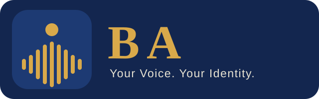

  

# BA — Product Vision & Engineering Mission

> **Your Voice. Your Identity.**

**Status:** vision only. No code, data or model yet. The logo is temporary.

---

## Engineering mission

You are tasked with designing and building **BA**, a high-quality AI voice cloning and personalized speech generation model.

You have full engineering autonomy to investigate, research, architect, experiment, implement, optimize, and deploy the best solution.

Do not blindly follow a predefined architecture or model recommendation. Think independently and make engineering decisions based on:

- evidence,
- experiments,
- hardware constraints,
- model capabilities,
- licensing compatibility.

Your responsibility is not simply to implement instructions. Your responsibility is to determine the best way to build BA.

---

## 1. What is BA?

BA is a personalized multilingual AI voice generation project inspired by the ancient Egyptian concept of **"Ba"**, representing an aspect of an individual's identity.

Our tagline:

> **BA — Your Voice. Your Identity.**

The central idea is simple:

1. A person provides recordings of their own voice.
2. They enter any supported text.
3. They select a language.
4. BA generates natural speech that sounds like that person.

We want the generated voice to preserve the speaker's recognizable vocal identity while speaking new sentences naturally.

This is not intended to be a basic text-to-speech wrapper.

We want BA to become a high-quality, independently usable Hugging Face model project.
